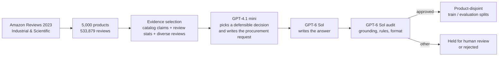
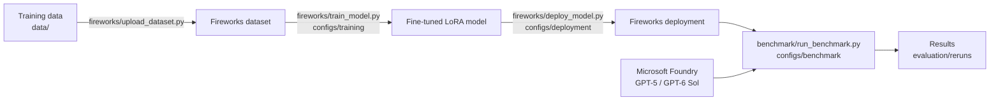

# Specializing small models

**Can a small, fine-tuned open model beat a big generalist LLM like GPT-5 and GPT-5.6 Luna on a narrow business task — and what does it take?**

We answered that question with two use cases, end to end: building the training data, fine-tuning on
[Fireworks AI](https://fireworks.ai), deploying, and benchmarking against general-purpose models.
This repository holds the data, the recipes, the scripts and every model answer behind the conclusions.

| | Amazon reviews — purchasing copilot | Banking77 — intent classification |
|---|---|---|
| **Task** | Read a procurement request plus a product's catalog data and customer reviews; decide `BUY`, `CONDITIONAL_BUY`, `DO_NOT_BUY` or `INSUFFICIENT_EVIDENCE` and justify it | Classify a bank customer's message into 1 of 77 intents |
| **Training data** | 731 examples we **generated and audited** from Amazon Reviews 2023 | 9,002 labelled public examples |
| **Specialized model** | Qwen3-4B + LoRA, fine-tuned on Fireworks | Qwen3.5-0.8B and Qwen3-0.6B + LoRA |
| **Compared with** | GPT-5, GPT-4.1 mini, Qwen3-4B without fine-tuning | GPT-5.6 Luna (direct and as an agent), GPT-4o agent |
| **Test set** | 103 products never seen in training | 3,080 standard test messages |

> **New here?** Run `make results` (no accounts needed, ~1 minute) and read the
> [executive summary](docs/EXECUTIVE_SUMMARY.md).

---

## What we concluded

**1. The specialized small model takes the best decisions.**

| Amazon purchasing copilot (103 cases) | Right decision | Median response | Tokens for 103 answers |
|---|---:|---:|---:|
| **Qwen3-4B fine-tuned** | **54.4%** | **1.2 s** | 247k |
| GPT-4.1 mini | 43.7% | 3.4 s | 244k |
| GPT-5 | 37.9% | 25.0 s | 470k |
| Qwen3-4B before fine-tuning | 27.2% | 1.3 s | 243k |

| Banking77 (3,080 cases) | Accuracy | Macro-F1 | Tokens per request |
|---|---:|---:|---:|
| **Qwen3.5-0.8B fine-tuned** | **86.9%** | **86.9%** | ~13 |
| Qwen3-0.6B fine-tuned | 85.1% | 85.1% | ~13 |
| GPT-5.6 Luna | 85.2% | 84.4% | 444 |
| GPT-5.6 Luna as an agent | 84.7% | 84.0% | 4,903 |
| GPT-4o as an agent | 78.2% | 77.4% | 917 |

Fine-tuning doubled the accuracy of Qwen3-4B on the purchasing task (27% → 54%) and lifted Qwen3.5-0.8B on
Banking77 from 28% to 87%. In both cases the specialized model ends up ahead of the large generalists.

**2. General-purpose models fail in characteristic ways that fine-tuning removes.**
GPT-5 recommended `BUY` 52 times when the reference had 4; GPT-4.1 mini never answered
`INSUFFICIENT_EVIDENCE`; the untuned Qwen3-4B answered `CONDITIONAL_BUY` 85 times out of 103. The fine-tuned
model learned the expected decision mix from the examples. Wrapping a large model in an agent did not help
on Banking77: lower accuracy and 11× more tokens than calling it directly.

**3. It is much cheaper and faster to run.**
GPT-5 spent 220k hidden reasoning tokens to answer the 103 purchasing cases and took 25 s per answer; the
fine-tuned model answered in about a second. On Banking77 the frontier model processed ~35× more tokens per
request. Against GPT-5's token mix, a dedicated USD 8/h GPU pays for itself above ~300 requests per hour.

**4. Large models still write better explanations.**
A blind GPT-6 Sol judge preferred GPT-5's rationales (score 63.7 vs 60.4 for the fine-tuned model) for
grounding and evidence coverage. Against GPT-4.1 mini the fine-tuned model won on both decision and
explanation (61.0 vs 53.6).

**5. Specialization is cheap; good data is the real investment.**
The Fireworks training job took 9 minutes and about USD 0.86. Most of the effort went into producing
audited, product-disjoint training examples with explicit decision rules.

**Recommended design:** the fine-tuned model takes the decision and drafts the answer, a large model
reviews high-value or low-confidence cases, and a human approves anything that commits money.
Details: [results](docs/RESULTS.md) · [how to read them](docs/SCOPE.md) · [cost](docs/COST_AND_DEPLOYMENT.md).

---

## How we built the datasets

### Amazon reviews: generated, audited, product-disjoint

No dataset of "should we buy this?" decisions existed, so we generated one from real catalog data and
reviews and audited every example before using it.



- **One example per product.** All reviews and variants of a product stay in one split, so the test
  products are never seen in training.
- **Explicit decision rules** ([review rules](docs/DATASET_REVIEW_RULES.md)): separate seller claims from
  customer experience, never invent specifications, call a problem *recurring* only if it appears in at
  least two reviews and more than 20% of them, and use `INSUFFICIENT_EVIDENCE` when a missing fact decides
  whether the product can do the job.
- **A fixed output contract**: `Result`, `Rationale`, `Missing information`, `Pros`, `Risks and limitations`.
- **Independent audit**: only examples approved by a separate audit pass are exported. From 1,822 generated
  examples, 1,220 were approved; the published model was trained on 731 of them.

Details: [dataset](docs/DATASET.md) · [generation pipeline](docs/DATASET_GENERATION.md).

### Banking77: a public labelled benchmark

[Banking77](https://huggingface.co/datasets/PolyAI/banking77) already provides 13,083 labelled messages.
We converted it to chat format (instruction → customer message → intent label) and split 10% of the training
set off for validation: 9,002 train · 1,001 validation · 3,080 test. It shows the simplest case for
specialization: a fixed set of labels and an exact answer key.

---

## How we fine-tuned

Supervised fine-tuning with LoRA adapters: the base model stays frozen and a small set of extra weights
learns the task, so training is fast and the result can share a GPU with other adapters.

| | Amazon reviews | Banking77 |
|---|---|---|
| **Where** | Fireworks AI (`firectl sftj create`) | Hugging Face Transformers + PEFT (reported results); Fireworks recipe included |
| **Base model** | Qwen3-4B | Qwen3.5-0.8B, Qwen3-0.6B (Fireworks recipe: Qwen3-4B) |
| **Examples · epochs** | 731 · 1 | 9,002 · 2 (Fireworks recipe: 3) |
| **LoRA rank · learning rate · batch** | 8 · 1e-4 · 8 | 8 · 1e-4 · 8 |
| **Training time · cost** | 9 min · ~USD 0.86 | 4.1 h on a laptop (Fireworks job: ~2.5 h · ~USD 0.77) |
| **Recipe in this repo** | `configs/training/amazon-reviews.toml` | `configs/training/banking77.toml` |

The Fireworks records of the published training jobs (job, model and dataset metadata) are in
`records/fireworks/`, and every new training run saves its own in `evaluation/reruns/training/`; the
[fine-tuning record](docs/FINETUNING.md) lists every parameter, and the
[Fireworks workflow](docs/FIREWORKS_WORKFLOW.md) shows the `firectl` commands from upload to deployment.

### How we compared the models

- **Same prompt and test cases for every model**; deterministic decoding (temperature 0) for the Qwen models.
- **Decision accuracy and F1** against the audited reference label: the primary metric.
- **Blind LLM judge** (GPT-6 Sol): scores three anonymized answers per case for grounding, evidence coverage,
  rule compliance and actionability, as a second view on explanation quality.
- **Tokens and latency** recorded for every request.

Every answer and every judgment is stored in `evaluation/`, and `make results` recomputes all metrics from
them. Method: [benchmark methodology](docs/BENCHMARK_METHODOLOGY.md).

---

## Quick start

Works on macOS, Linux and Windows. Every command below is the same on all of them.

### Prerequisites

| To... | You need |
|---|---|
| See the results (step 1) | [Python](https://www.python.org/downloads/) 3.10+, [Git](https://git-scm.com/downloads) and GNU Make (on Windows, from WSL or Git Bash) |
| Run the process (step 2) | Also: a [Fireworks AI](https://fireworks.ai) account with an API key and [`firectl`](https://docs.fireworks.ai/tools-sdks/firectl/firectl); a [Microsoft Foundry](https://learn.microsoft.com/azure/ai-foundry/) resource with two model deployments already created: **GPT-5** (baseline) and **GPT-6 Sol** (judge) |

No Python packages are needed: the scripts use only the standard library. If your Python command is
`python` or `py` rather than `python3`, add it to any make command, e.g. `make results PY=python`.

### 1. See the results (offline, no accounts)

```bash
git clone https://github.com/southworks/fireworks-fine-tuning.git
cd fireworks-fine-tuning
make results
```

This validates the data, recomputes every metric from the stored model answers, and prints the results
and a few answers side by side.

### 2. Run the process yourself (Fireworks + Microsoft Foundry)

1. Copy `.env.example` to `.env` and fill in:
   - the Fireworks API key (or run `firectl signin` instead);
   - the Foundry endpoint and key;
   - the names of your GPT-5 and GPT-6 Sol deployments in Foundry (`FOUNDRY_GPT5_DEPLOYMENT`, `FOUNDRY_GPT6_SOL_DEPLOYMENT`).
2. Run the processes, one by one or all together with `make pipeline`:

```bash
make upload-datasets          # training data -> Fireworks
make train-models             # fine-tune Qwen3-4B (Amazon ~10 min, Banking77 ~2.5 h)
make deploy-models            # base model + fine-tuned models on Fireworks (scale to zero when idle)
make exec-benchmark           # base vs fine-tuned vs GPT-5 (+ blind judge for Amazon)
make undeploy                 # delete the Fireworks deployments
```

Each process also exists per use case, so one case can run on its own. For example, Banking77 only:

```bash
make upload-dataset-banking77 train-model-banking77
make deploy-base-model deploy-ft-model-banking77 exec-benchmark-banking77 undeploy
```

| Option | Example | Effect |
|---|---|---|
| `DRY_RUN=1` | `make train-models DRY_RUN=1` | Print the exact `firectl` commands without running them |
| `LIMIT=n` | `make exec-benchmark LIMIT=10` | Benchmark a sample instead of the full test set |
| `FORCE=1` | `make upload-datasets FORCE=1` | Replace a Fireworks resource that already exists |

`make help` lists every target. New results are written to `evaluation/reruns/`, next to (never over)
the published ones.

---

## How the repository works



Every step is a small Python script driven by a config file. The scripts call the official CLIs
(`firectl`) and print each command, so they double as a reference for doing the same by hand.
To adapt the study to a new use case, add a dataset and copy the config files.

| To change... | Edit |
|---|---|
| Training recipe (epochs, learning rate, LoRA rank...) | `configs/training/*.toml` |
| Hardware and scaling | `configs/deployment/*.toml` |
| Models compared, test set, judge | `configs/benchmark/*.toml` |

---

## What's in the repository

```text
├── Makefile                  entry point: make results, make <process>
├── configs/                  training, deployment and benchmark settings (TOML)
├── data/
│   ├── dataset/              Amazon purchasing-copilot data (fireworks_v2_training.jsonl = published model's training set)
│   ├── source/               product selection used to build it from Amazon Reviews 2023
│   └── banking77/            Banking77 train / validation / test
├── evaluation/
│   ├── qwen3-4b-amazon-v2/   published benchmark: test cases, every model's answers, judge scores, RESULTS.md
│   └── banking77/            Banking77 results
├── records/fireworks/        Fireworks records of the jobs, models and datasets behind the published results
├── scripts/
│   ├── dataset/              Amazon dataset generation (source selection, example generation and audit)
│   ├── fireworks/            Fireworks AI: upload, train, deploy, undeploy, inference
│   ├── foundry/              Microsoft Foundry: client and inference
│   ├── benchmark/            benchmark runner, judge, metrics, reports, Banking77 scoring
│   ├── results/              make results: validation, checksums, side-by-side cases
│   └── common/               shared helpers (paths, .env and TOML configs, commands, JSONL)
└── docs/                     explanations (see below)
```

---

## Documentation

| I want to... | Read |
|---|---|
| Understand the business case in 5 minutes | [Executive summary](docs/EXECUTIVE_SUMMARY.md) |
| See all the numbers | [Results](docs/RESULTS.md) · [full tables](evaluation/qwen3-4b-amazon-v2/RESULTS.md) · [Banking77](evaluation/banking77/README.md) |
| Know how far the results generalize | [Scope and interpretation](docs/SCOPE.md) |
| Learn the Fireworks workflow (firectl) | [Fireworks workflow](docs/FIREWORKS_WORKFLOW.md) |
| See the exact training jobs and their cost | [Fine-tuning record](docs/FINETUNING.md) |
| Estimate cost and choose a deployment | [Cost and deployment](docs/COST_AND_DEPLOYMENT.md) |
| Understand the data and how it was built | [Dataset](docs/DATASET.md) · [Generation](docs/DATASET_GENERATION.md) · [Review rules](docs/DATASET_REVIEW_RULES.md) |
| Understand how models were compared | [Benchmark methodology](docs/BENCHMARK_METHODOLOGY.md) |
| Reproduce or extend the work | [Reproducibility](docs/REPRODUCIBILITY.md) |

---

## Data sources

- **Amazon Reviews 2023** (Industrial & Scientific), McAuley Lab —
  [project](https://amazon-reviews-2023.github.io/) · [paper](https://arxiv.org/abs/2403.03952).
  The repository contains derived examples; the raw reviews are downloaded from the source by
  `scripts/dataset/build_source_subset.py`. Product names, reviews and trademarks belong to their owners.
- **Banking77**, PolyAI — [dataset](https://huggingface.co/datasets/PolyAI/banking77) ·
  [paper](https://arxiv.org/abs/2003.04807), CC BY 4.0. Converted to chat format; validation is a stratified
  10% of the training split (seed 42).

