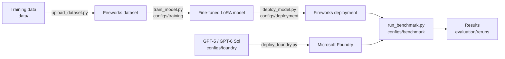

# Fine-tuning small models on Fireworks AI

**A Southworks × Fireworks AI case study: when a small fine-tuned model beats a large general-purpose LLM, and how to prove it.**

We took Qwen3-4B, fine-tuned it on [Fireworks AI](https://fireworks.ai) for two narrow business tasks, and
compared it with GPT-4.1 mini and GPT-5. This repository contains everything behind the results: the data,
the training recipes, the deployment and benchmark scripts, and every model answer.

> **New here?** Run `make results` (no accounts, ~1 minute), then read the
> [executive summary](docs/EXECUTIVE_SUMMARY.md).

---

## Results at a glance

**Amazon purchasing copilot** — decide `BUY` / `CONDITIONAL_BUY` / `DO_NOT_BUY` / `INSUFFICIENT_EVIDENCE`
for an industrial product from its catalog data and customer reviews (103 test cases).

| Model | Right decision | Median response time | Tokens for 103 answers |
|---|---:|---:|---:|
| **Qwen3-4B fine-tuned** | **54.4%** | **1.2 s** | 247k |
| GPT-4.1 mini | 43.7% | 3.4 s | 244k |
| GPT-5 | 37.9% | 25.0 s | 470k |
| Qwen3-4B before fine-tuning | 27.2% | 1.3 s | 243k |

**Banking77** — classify a customer message into 1 of 77 intents (3,080 test cases).

| Model | Accuracy | Tokens per request |
|---|---:|---:|
| **Qwen3.5-0.8B fine-tuned** | **86.9%** | ~13 |
| GPT-5.6 Luna | 85.2% | 444 |

**In short:** fine-tuning took 731 examples, a 9-minute job and under USD 1 on Fireworks, and produced the
most accurate and fastest model for the decision. GPT-5 still writes the best-grounded explanations, so the
recommended design is *fine-tuned model decides, large model reviews, human approves*.
Details: [results](docs/RESULTS.md) · [how to read them](docs/SCOPE.md).

---

## Quick start

### 1. See the results (offline)

Requires Python 3.10+ and `make`. Nothing to install, no accounts.

```bash
git clone https://github.com/southworks/fireworks-fine-tuning.git
cd fireworks-fine-tuning
make results
```

This validates the data, recomputes every metric from the stored model answers, and prints the results
and a few answers side by side.

### 2. Run the process yourself (Fireworks + Microsoft Foundry)

Prerequisites:

- [ ] Fireworks account and API key — install the CLI: `brew tap fw-ai/firectl && brew install firectl`
- [ ] Azure subscription with a Microsoft Foundry resource — install the CLI: `brew install azure-cli`, then `az login`
- [ ] `cp .env.example .env` and fill in the keys and resource names

Then run the processes one by one, or all together with `make pipeline`:

```bash
make deploy-foundry-models    # GPT-5 (baseline) and GPT-6 Sol (judge) on Microsoft Foundry
make upload-datasets          # training data -> Fireworks
make train-models             # fine-tune Qwen3-4B (Amazon ~10 min, Banking77 ~2.5 h)
make deploy-models            # base model + fine-tuned models on Fireworks (scale to zero when idle)
make exec-benchmark           # base vs fine-tuned vs GPT-5 (+ blind judge for Amazon)
make undeploy                 # delete the Fireworks deployments
```

| Option | Example | Effect |
|---|---|---|
| `DRY_RUN=1` | `make train-models DRY_RUN=1` | Print the exact `firectl` / `az` commands without running them |
| `LIMIT=n` | `make exec-benchmark LIMIT=10` | Benchmark a sample instead of the full test set |
| `FORCE=1` | `make upload-datasets FORCE=1` | Replace a Fireworks resource that already exists |

`make help` lists every target, including single-case ones such as `make train-model-banking77`.
New results are written to `evaluation/reruns/`, next to (never over) the published ones.

> Want to benchmark the exact models behind the published results without training?
> `make deploy-base-model deploy-published-models exec-benchmark-published`

---

## How it works



Every step is a small Python script driven by a config file. The scripts call the official CLIs
(`firectl`, `az`) and print each command, so they double as a reference for doing the same by hand.
To adapt the study to a new use case, add a dataset and copy the config files.

| To change... | Edit |
|---|---|
| Training recipe (epochs, learning rate, LoRA rank...) | `configs/training/*.toml` |
| Hardware and scaling | `configs/deployment/*.toml` |
| Models compared, test set, judge | `configs/benchmark/*.toml` |
| Foundry models and capacity | `configs/foundry/models.toml` |

---

## What's in the repository

```text
├── Makefile                  entry point: make results, make <process>
├── configs/                  training, deployment, Foundry and benchmark settings (TOML)
├── data/
│   ├── dataset/              Amazon purchasing-copilot data (fireworks_v2_training.jsonl = published model's training set)
│   ├── source/               product selection used to build it from Amazon Reviews 2023
│   └── banking77/            Banking77 train / validation / test
├── evaluation/
│   ├── qwen3-4b-amazon-v2/   published benchmark: test cases, every model's answers, judge scores, RESULTS.md
│   └── banking77/            Banking77 results
├── records/fireworks/        Fireworks records of the training jobs, models and datasets
├── scripts/                  one script per process + validation, metrics and report tools
└── docs/                     explanations (see below)
```

---

## Documentation

| I want to... | Read |
|---|---|
| Understand the business case in 5 minutes | [Executive summary](docs/EXECUTIVE_SUMMARY.md) |
| See all the numbers | [Results](docs/RESULTS.md) · [full tables](evaluation/qwen3-4b-amazon-v2/RESULTS.md) · [Banking77](evaluation/banking77/README.md) |
| Know how far the results generalize | [Scope and interpretation](docs/SCOPE.md) |
| Learn the Fireworks workflow (firectl) | [Fireworks workflow](docs/FIREWORKS_WORKFLOW.md) |
| See the exact training jobs and their cost | [Fine-tuning record](docs/FINETUNING.md) |
| Estimate cost and choose a deployment | [Cost and deployment](docs/COST_AND_DEPLOYMENT.md) |
| Understand the data and how it was built | [Dataset](docs/DATASET.md) · [Generation](docs/DATASET_GENERATION.md) · [Review rules](docs/DATASET_REVIEW_RULES.md) |
| Understand how models were compared | [Benchmark methodology](docs/BENCHMARK_METHODOLOGY.md) |
| Reproduce or extend the work | [Reproducibility](docs/REPRODUCIBILITY.md) |

---

## Data sources

- **Amazon Reviews 2023** (Industrial & Scientific), McAuley Lab —
  [project](https://amazon-reviews-2023.github.io/) · [paper](https://arxiv.org/abs/2403.03952).
  The repository contains derived examples; the raw reviews are downloaded from the source by
  `scripts/build_source_subset.py`. Product names, reviews and trademarks belong to their owners.
- **Banking77**, PolyAI — [dataset](https://huggingface.co/datasets/PolyAI/banking77) ·
  [paper](https://arxiv.org/abs/2003.04807), CC BY 4.0. Converted to chat format; validation is a stratified
  10% of the training split (seed 42).
- **Qwen3** models by the Qwen team, served and fine-tuned on Fireworks AI.
